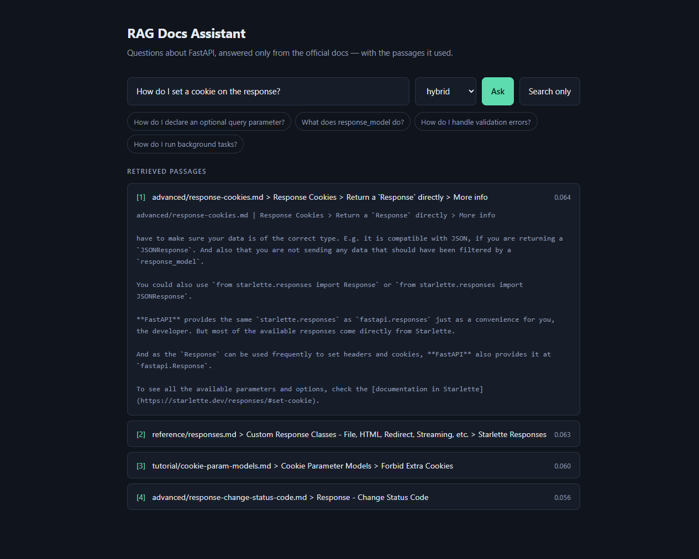

# RAG Docs Assistant

Ask questions about the [FastAPI](https://fastapi.tiangolo.com/) documentation and get answers grounded in the actual docs, with the source passages attached.

A small, complete Retrieval-Augmented Generation system: markdown-aware chunking, local embeddings, a vector store, hybrid retrieval, a Claude generation step, a FastAPI service, and — the part most RAG demos skip — **a labelled evaluation harness that measures whether retrieval actually works.**

Runs entirely on a laptop. One API key, and only for the generation step.



---

## Why hybrid retrieval

Retrieval is where RAG systems fail. Almost every "the AI is hallucinating" report in a RAG product turns out to be the model answering faithfully from the wrong passages. So the interesting question is not "does it answer" but "how often does the right page come back" — which is measurable.

The three retrievers in `app/retrieve.py` are scored against two hand-labelled question sets, at k = 4 — the same four chunks the model receives:

| strategy | main (22 q)<br>Hit@4 · MRR@4 | identifiers (8 q)<br>Hit@4 · MRR@4 |
|---|:--:|:--:|
| vector | 100.0% · 0.943 | 100.0% · 0.812 |
| keyword (BM25) | 90.9% · 0.663 | 87.5% · 0.562 |
| **hybrid (weighted RRF)** | **100.0% · 0.943** | **100.0% · 0.875** |

**Reading this:** *Hit@4* asks whether a correct page appeared in the four chunks handed to the model — could it possibly have answered? *MRR@4* asks where in the list it landed; a system that always scrapes in at position 4 is one bad day from breaking.

### The result I didn't expect

I built hybrid retrieval expecting it to beat both single retrievers. **With textbook equal-weight RRF it was worse than vector search alone** — 0.864 against 0.943.

`--verbose` showed why. BM25 saw the literal string `StaticFiles` in the API *reference* page and ranked it above the *tutorial* page that actually answers "how do I serve static files?". Equal-weight fusion let the weaker retriever overrule the stronger one.

Weighting the fusion 3:1 toward vector fixed that — but that only proved hybrid did no *harm*. The main question set is 22 paraphrased questions, which is vector search's home turf; it structurally could not show BM25 contributing anything. So I wrote a second set aimed at the case where exact-token matching should matter, and there hybrid wins: **0.875 vs 0.812**.

That is the argument for shipping it: free on the questions vector already handles, better on a class it handles less well. The full write-up, including why the shipped weight is a round 3:1 rather than the 4:1 that scored highest, is in **[`evaluation/README.md`](evaluation/README.md)**.

RRF fuses **ranks**, not scores, deliberately: cosine similarity and BM25 live on incomparable scales, and any weighted-sum normalisation needs constants you would re-tune every time the corpus changed.

---

## Quickstart

```bash
git clone https://github.com/LuisEduardoGE/rag-docs-assistant
cd rag-docs-assistant

python -m venv .venv
source .venv/bin/activate        # Windows: .venv\Scripts\activate
pip install -r requirements.txt

python -m app.fetch_docs         # download the FastAPI docs (~18 MB)
python -m app.index              # chunk + embed + build the index
python -m evaluation.run_eval    # reproduce the table above
```

Everything above works with **no API key** — the embedding model runs locally.

To get generated answers, add a key and start the server:

```bash
cp .env.example .env             # then paste your key in
export ANTHROPIC_API_KEY=sk-ant-...
uvicorn app.api:app --reload
```

Open <http://127.0.0.1:8000>.

---

## How it works

Two phases that run at completely different times, sharing exactly one thing — the index.

**Phase 1 — indexing (offline, minutes, nobody waiting):**

```
docs/*.md  →  chunk  →  embed  →  LanceDB
```

**Phase 2 — answering (per question, sub-second):**

```
question  →  ┌ embed → vector search ┐
             │                        ├→ RRF fusion → top 4 → Claude → answer + citations
             └ BM25 keyword search   ┘
```

| File | Responsibility |
|---|---|
| `app/fetch_docs.py` | Download the corpus (not vendored into the repo) |
| `app/chunk.py` | Markdown-aware splitting — **the highest-leverage file here** |
| `app/embed.py` | Text → vectors. Isolated so the model is swappable |
| `app/index.py` | Build the LanceDB table |
| `app/retrieve.py` | Vector, BM25, and RRF-fused retrieval |
| `app/generate.py` | Prompt assembly + the Claude call |
| `app/api.py` | `/search` (free), `/ask` (needs a key), `/health` |
| `evaluation/` | Labelled question set + scoring |

### Chunking decisions

Retrieval can only return chunks you created, so a bad split puts the answer permanently out of reach. Three choices, all in `app/chunk.py`:

1. **Split on markdown headings, not a fixed character count.** A heading is the author telling you where one idea ends. Slicing every 1000 characters ignores that and is the most common cause of a garbage-retrieving first build.

2. **Prepend the heading path to every chunk.** A chunk reading *"It defaults to 422."* is unfindable. The same chunk prefixed `tutorial/handling-errors.md | Handling Errors > Validation errors` contains the words someone would actually search for. This is the cheapest single improvement available to most RAG systems.

3. **Pack across section boundaries, then overlap.** Splitting strictly per-section sounds tidier, but the FastAPI docs have many short subsections and it produced a corpus with a **median chunk of 72 words** — too little signal to match reliably. Packing across headings while keeping the boundary visible moved the median to **256 words**. A 40-word overlap stops an answer that straddles a boundary from being cut in half.

### Generation

`claude-opus-5`, at `effort: "low"`. Grounded extraction from four short passages is not a hard reasoning problem — the answer is sitting in the text — so low effort keeps latency and cost down with no quality loss on this task. The system prompt requires inline citations and requires the model to say it doesn't know rather than fall back on its own knowledge of FastAPI.

`stop_reason == "refusal"` is handled explicitly: on a refusal the content list is empty, and reading `content[0]` blindly turns a declined request into a 500.

---

## Debugging retrieval

`POST /search` runs retrieval **without** a model call — no key, no cost. When an answer is wrong, look here first:

```bash
curl -s localhost:8000/search \
  -H 'content-type: application/json' \
  -d '{"question":"How do I set a cookie?","strategy":"hybrid"}' | jq '.results[].source'
```

If the right page isn't in that list, no amount of prompt engineering will fix the answer. Compare `"strategy": "vector"` against `"keyword"` to see which half is failing.

---

## What I'd do next

Being honest about the edges, in rough order of expected payoff:

- **A reranker.** A cross-encoder scoring each candidate against the question directly is usually the largest quality win after basic retrieval works. `"How do I cancel?"` and `"How do I renew?"` sit next to each other on the meaning map; a reranker separates them.
- **A better embedding model.** `bge-small` is 384-dimensional and chosen to run locally with no key. A hosted model (Anthropic recommends Voyage AI; Anthropic does not serve embeddings itself) would score higher.
- **Answer-quality evaluation.** This harness scores retrieval only. Grading the generated prose needs a model-as-judge and a longer argument about whether the judge is right.
- **Prompt caching.** The system prompt here is under the 512-token cache minimum, so caching would be a no-op. It would pay off as soon as the instructions grow.
- **Incremental indexing.** `python -m app.index` rebuilds everything. Fine for 154 documents, wrong for 154,000.

## Notes

- The corpus and index live in `data/` and are gitignored. Both are rebuilt by the two commands in the quickstart.
- On Windows, `python -m app.index` can hit `UnicodeEncodeError` when printing — the FastAPI docs contain emoji and the default console codepage is cp1252. `set PYTHONIOENCODING=utf-8` fixes it.
- The FastAPI documentation is © Sebastián Ramírez, MIT licensed. It is downloaded at runtime, never redistributed here.
