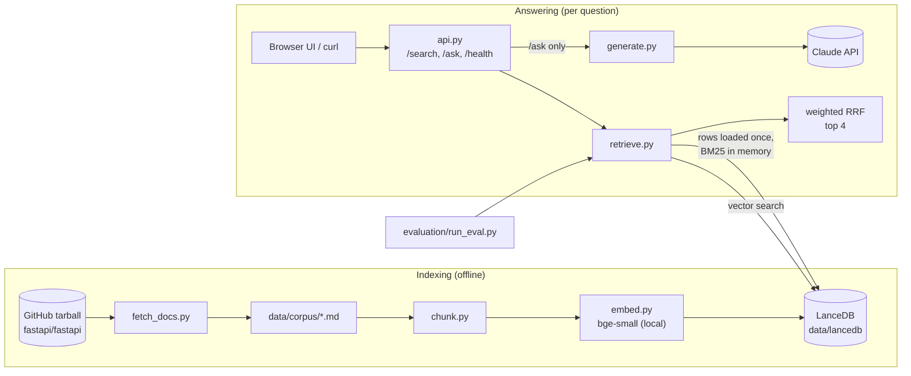

# RAG Docs Assistant

**Ask questions about the [FastAPI](https://fastapi.tiangolo.com/) documentation and get answers grounded in the actual docs, with the source passages attached.**

[](https://github.com/LuisEduardoGE/rag-docs-assistant/actions/workflows/ci.yml)
[](LICENSE)


A small, complete Retrieval-Augmented Generation system: markdown-aware chunking, local embeddings, a vector store, hybrid retrieval, a Claude generation step, a FastAPI service, and — the part most RAG demos skip — **a labelled evaluation harness that measures whether retrieval actually works.**

Runs entirely on a laptop. One API key, and only for the generation step.


## Table of Contents

- [Features](#features)
- [Tech Stack](#tech-stack)
- [Architecture](#architecture)
- [Quick Start](#quick-start)
- [Configuration](#configuration)
- [API](#api)
- [Testing](#testing)
- [Project Structure](#project-structure)
- [Why hybrid retrieval](#why-hybrid-retrieval)
- [Chunking decisions](#chunking-decisions)
- [Generation](#generation)
- [Debugging retrieval](#debugging-retrieval)
- [What I'd do next](#what-id-do-next)
- [Notes](#notes)

## Features

- Three retrievers over the same index — vector, BM25 keyword, and hybrid (weighted Reciprocal Rank Fusion, 3:1 toward vector).
- Markdown-aware chunking that splits on headings, prefixes every chunk with its heading path, and overlaps neighbours.
- Local embeddings (`bge-small-en-v1.5` through ONNX Runtime): no GPU, no API key, no per-query cost.
- Embedded LanceDB vector store — a folder on disk, no server to run.
- `POST /search` for retrieval only (free) and `POST /ask` for grounded, cited answers from Claude.
- An evaluation harness with two hand-labelled question sets, scored by Hit@k and MRR@k.
- A small browser UI served at `/`.

## Tech Stack

| Layer | Choice |
|---|---|
| Web API | FastAPI + Uvicorn, Pydantic v2 |
| Vector store | LanceDB (embedded), PyArrow schema |
| Embeddings | fastembed, `BAAI/bge-small-en-v1.5` (384 dimensions) |
| Keyword search | BM25 in plain Python over the loaded chunks |
| Fusion | Weighted Reciprocal Rank Fusion (k = 60, vector 3 : keyword 1) |
| Generation | Anthropic Python SDK (`claude-opus-5`, `effort: "low"` by default) |
| Corpus download | httpx (GitHub tarball of the FastAPI repo) |
| Tooling | pytest, Ruff, GitHub Actions |

## Architecture



Two phases that run at completely different times, sharing exactly one thing — the index.

**Phase 1 — indexing (offline, minutes, nobody waiting):**

```
docs/*.md  →  chunk  →  embed  →  LanceDB
```

**Phase 2 — answering (per question, sub-second):**

```
question  →  ┌ embed → vector search ┐
             │                        ├→ RRF fusion → top 4 → Claude → answer + citations
             └ BM25 keyword search   ┘
```

The store is loaded once per process and BM25 statistics are built from the same rows, so vector and keyword search rank exactly the same chunks. The evaluation harness calls the same `retrieve()` entry point as the API.

## Quick Start

Prerequisites: Python 3.10+, `make` (optional).

```bash
git clone https://github.com/LuisEduardoGE/rag-docs-assistant
cd rag-docs-assistant
python -m venv .venv
source .venv/bin/activate        # Windows: .venv\Scripts\activate

make install                     # runtime + dev dependencies
make fetch                       # download the FastAPI docs (~18 MB)
make index                       # chunk + embed + build the index
make eval                        # reproduce the retrieval table
make run                         # http://127.0.0.1:8000 (PORT=... to change)
```

Without make:

```bash
pip install -r requirements.txt

python -m app.fetch_docs         # download the FastAPI docs (~18 MB)
python -m app.index              # chunk + embed + build the index
python -m evaluation.run_eval    # reproduce the table below
```

Everything above works with **no API key** — the embedding model runs locally (the first `index` run downloads it, ~130 MB).

To get generated answers, add a key and start the server:

```bash
cp .env.example .env             # then paste your key in
export ANTHROPIC_API_KEY=sk-ant-...
uvicorn app.api:app --reload
```

Open <http://127.0.0.1:8000>.

## Configuration

The app reads environment variables only; `.env` is a template and is not loaded automatically.

| Variable | Default | Purpose |
|---|---|---|
| `ANTHROPIC_API_KEY` | none | Needed for `POST /ask` only. Retrieval, `/search` and the evaluation harness run without it. |
| `ANTHROPIC_MODEL` | `claude-opus-5` | Model used for generation. |
| `ANTHROPIC_EFFORT` | `low` | Effort setting sent with each generation request. |

Retrieval and chunking knobs (`TOP_K`, `CANDIDATE_K`, `RRF_K`, fusion weights, chunk sizes) live in `app/config.py`, so a change can be re-scored with `make eval`.

## API

| Endpoint | Purpose |
|---|---|
| `GET /` | Browser UI |
| `GET /health` | Index loaded, and how many chunks it holds |
| `POST /search` | Retrieval only — no model call, no key, no cost |
| `POST /ask` | Retrieval + generation; returns the answer, sources and token usage (needs `ANTHROPIC_API_KEY`, 502 otherwise) |

Both `POST` endpoints take `{"question": "...", "k": 4, "strategy": "hybrid"}`; `k` is 1–20 and `strategy` is `hybrid`, `vector` or `keyword`.

## Testing

```bash
make test                        # pytest
make lint                        # ruff check .
```

28 tests pass, with no API key, no network and no model download. They cover BM25 tokenisation, keyword, vector and hybrid search against a three-chunk LanceDB table built in a temp dir with hand-made vectors (including that the fusion weights decide which retriever wins a disagreement, and the exact RRF score), chunking (heading paths, anchors, code fences, cleaning, packing, overlap), prompt building and refusal handling with a fake client, the Hit@k / MRR@k maths, and the `/health`, `/search` and `/` endpoints. CI runs them on Python 3.10 and 3.12.

## Project Structure

| Path | Responsibility |
|---|---|
| `app/fetch_docs.py` | Download the corpus (not vendored into the repo) |
| `app/chunk.py` | Markdown-aware splitting — **the highest-leverage file here** |
| `app/embed.py` | Text → vectors. Isolated so the model is swappable |
| `app/index.py` | Build the LanceDB table |
| `app/retrieve.py` | Vector, BM25, and RRF-fused retrieval |
| `app/generate.py` | Prompt assembly + the Claude call |
| `app/api.py` | `/search` (free), `/ask` (needs a key), `/health`, and the UI |
| `app/config.py` | Every tunable value in one place |
| `app/static/` | The browser UI |
| `evaluation/` | Labelled question sets + scoring ([write-up](evaluation/README.md)) |
| `tests/` | pytest suite |
| `docs/` | Screenshot and the scripts that build the HTML build-along guide |

## Why hybrid retrieval

Retrieval is where RAG systems fail. Almost every "the AI is hallucinating" report in a RAG product turns out to be the model answering faithfully from the wrong passages. So the interesting question is not "does it answer" but "how often does the right page come back" — which is measurable.

The three retrievers in `app/retrieve.py` are scored against two hand-labelled question sets, at k = 4 — the same four chunks the model receives:

| strategy | main (22 q)<br>Hit@4 · MRR@4 | identifiers (8 q)<br>Hit@4 · MRR@4 |
|---|:--:|:--:|
| vector | 100.0% · 0.943 | 100.0% · 0.812 |
| keyword (BM25) | 90.9% · 0.663 | 87.5% · 0.562 |
| **hybrid (weighted RRF)** | **100.0% · 0.943** | **100.0% · 0.875** |

**Reading this:** *Hit@4* asks whether a correct page appeared in the four chunks handed to the model — could it possibly have answered? *MRR@4* asks where in the list it landed; a system that always scrapes in at position 4 is one bad day from breaking.

The corpus is downloaded from FastAPI's `master` branch, so a fresh run drifts as the docs change. A run on 2026-11-24 (800 chunks) gave vector 0.943 / 0.812, keyword 0.625 / 0.542 and hybrid 0.920 / 0.875 MRR@4, with the same Hit@4 as above.

### The result I didn't expect

I built hybrid retrieval expecting it to beat both single retrievers. **With textbook equal-weight RRF it was worse than vector search alone** — 0.864 against 0.943.

`--verbose` showed why. BM25 saw the literal string `StaticFiles` in the API *reference* page and ranked it above the *tutorial* page that actually answers "how do I serve static files?". Equal-weight fusion let the weaker retriever overrule the stronger one.

Weighting the fusion 3:1 toward vector fixed that — but that only proved hybrid did no *harm*. The main question set is 22 paraphrased questions, which is vector search's home turf; it structurally could not show BM25 contributing anything. So I wrote a second set aimed at the case where exact-token matching should matter, and there hybrid wins: **0.875 vs 0.812**.

That is the argument for shipping it: free on the questions vector already handles, better on a class it handles less well. The full write-up, including why the shipped weight is a round 3:1 rather than the 4:1 that scored highest, is in **[`evaluation/README.md`](evaluation/README.md)**.

RRF fuses **ranks**, not scores, deliberately: cosine similarity and BM25 live on incomparable scales, and any weighted-sum normalisation needs constants you would re-tune every time the corpus changed.

## Chunking decisions

Retrieval can only return chunks you created, so a bad split puts the answer permanently out of reach. Three choices, all in `app/chunk.py`:

1. **Split on markdown headings, not a fixed character count.** A heading is the author telling you where one idea ends. Slicing every 1000 characters ignores that and is the most common cause of a garbage-retrieving first build.

2. **Prepend the heading path to every chunk.** A chunk reading *"It defaults to 422."* is unfindable. The same chunk prefixed `tutorial/handling-errors.md | Handling Errors > Validation errors` contains the words someone would actually search for. This is the cheapest single improvement available to most RAG systems.

3. **Pack across section boundaries, then overlap.** Splitting strictly per-section sounds tidier, but the FastAPI docs have many short subsections and it produced a corpus with a **median chunk of 72 words** — too little signal to match reliably. Packing across headings while keeping the boundary visible moved the median to **256 words**. A 40-word overlap stops an answer that straddles a boundary from being cut in half.

## Generation

`claude-opus-5`, at `effort: "low"`. Grounded extraction from four short passages is not a hard reasoning problem — the answer is sitting in the text — so low effort keeps latency and cost down with no quality loss on this task. The system prompt requires inline citations and requires the model to say it doesn't know rather than fall back on its own knowledge of FastAPI.

`stop_reason == "refusal"` is handled explicitly: on a refusal the content list is empty, and reading `content[0]` blindly turns a declined request into a 500.

## Debugging retrieval

`POST /search` runs retrieval **without** a model call — no key, no cost. When an answer is wrong, look here first:

```bash
curl -s localhost:8000/search \
  -H 'content-type: application/json' \
  -d '{"question":"How do I set a cookie?","strategy":"hybrid"}' | jq '.results[].source'
```

If the right page isn't in that list, no amount of prompt engineering will fix the answer. Compare `"strategy": "vector"` against `"keyword"` to see which half is failing.

## What I'd do next

Being honest about the edges, in rough order of expected payoff:

- **A reranker.** A cross-encoder scoring each candidate against the question directly is usually the largest quality win after basic retrieval works. `"How do I cancel?"` and `"How do I renew?"` sit next to each other on the meaning map; a reranker separates them.
- **A better embedding model.** `bge-small` is 384-dimensional and chosen to run locally with no key. A hosted model (Anthropic recommends Voyage AI; Anthropic does not serve embeddings itself) would score higher.
- **Answer-quality evaluation.** This harness scores retrieval only. Grading the generated prose needs a model-as-judge and a longer argument about whether the judge is right.
- **Prompt caching.** The system prompt here is under the 512-token cache minimum, so caching would be a no-op. It would pay off as soon as the instructions grow.
- **Incremental indexing.** `python -m app.index` rebuilds everything. Fine for the ~160 documents here, wrong for 160,000.

## Notes

- The corpus and index live in `data/` and are gitignored. Both are rebuilt by `make fetch` and `make index`.
- On Windows, `python -m app.index` can hit `UnicodeEncodeError` when printing — the FastAPI docs contain emoji and the default console codepage is cp1252. `set PYTHONIOENCODING=utf-8` fixes it.

## Author

**Luis Eduardo G. Espindola** · [GitHub](https://github.com/LuisEduardoGE) · [LinkedIn](https://www.linkedin.com/in/luisgespindola/)

## License

[MIT](LICENSE) © Luis Eduardo G. Espindola

The FastAPI documentation is © Sebastián Ramírez, MIT licensed. It is downloaded at runtime, never redistributed here.
